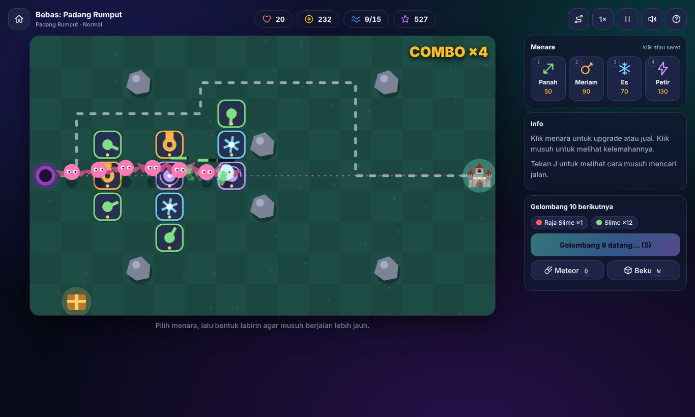

# 🏰 Towers

A tower defense game where **your towers are the maze**. Reroute enemies, complete 24 missions, and compete on replay-verified leaderboards. Vanilla HTML, CSS and JavaScript, with zero npm dependencies.



## ✨ Features

- **Campaign:** 24 missions in 4 chapters, 72 stars, mission rules such as tower limits or no skills
- **Daily Challenge, Free Play (6 maps, 3 difficulties) and Endless** mode
- **Live pathfinding:** BFS flow field, route preview, distance overlay, and no full blocking
- **4 towers, 6 enemy types**, Meteor and Freeze skills
- **Replayability:** bonus cards every 5 waves, treasure crates, combos, achievements
- **Beginner friendly:** interactive tutorial and in-game guide
- Responsive UI for mouse, keyboard and touch (interface in Indonesian)

## 🚀 Deploy to GitHub Pages

1. Push this project to the `main` branch, including the `.github` folder.
2. Open **Settings → Pages → Source** and choose **GitHub Actions**.
3. Open **Actions → Deploy to GitHub Pages → Run workflow** (later pushes deploy automatically).

The game works right away, with scores stored on the player's device. To run it locally, open `index.html`.

## 🌐 Online features (all optional)

```
Browser (GitHub Pages)
 ├─ GitHub Issues ─► GitHub Actions ─► replay check ─► data/leaderboard.json
 ├─ Node server (hosted elsewhere) ─► replay check ─► Supabase or JSON file
 └─ Supabase ─► accounts, cloud save, scores
```

GitHub Pages only serves static files, so the Node server and the database must be hosted outside Pages. Their code still lives in this repository.

### A. GitHub leaderboard (no extra service)

- Enable **Issues** in the repository settings.
- Under **Settings → Actions → General → Workflow permissions**, choose **Read and write permissions**.
- Players finish a game, click **Kirim lewat GitHub**, and create the pre-filled issue. A GitHub account is required.
- If `main` is protected against direct pushes, the workflow cannot save scores.

### B. Supabase (accounts, cloud save, online scores)

1. Create a Supabase project and run [`supabase/schema.sql`](supabase/schema.sql) in the SQL Editor.
2. In GitHub: **Settings → Secrets and variables → Actions → Variables**, add `SUPABASE_URL` and `SUPABASE_ANON_KEY` (publishable or anon key).
3. In Supabase Authentication settings, set the Site URL to your Pages URL.
4. Run the deploy workflow again.

⚠️ Never put the `service_role` or secret key in these variables or in `config.js`.

### C. Node server (verified online scores)

1. Host the repository on any Node 18+ service. `render.yaml` and `server/Dockerfile` are included. Start command: `node server/server.js`.
2. Server environment variables:

| Variable | Purpose |
|---|---|
| `ALLOWED_ORIGIN` | Your Pages origin, e.g. `https://username.github.io` |
| `SUPABASE_URL`, `SUPABASE_SERVICE_KEY` | Optional persistent storage. Keep the key on the server only. |
| `DATA_FILE` | Optional path for JSON storage when Supabase is not set |
| `PORT` | Defaults to 8787 |

3. Add the GitHub Actions variable `TOWERS_API_URL` and redeploy.

Without Supabase the server writes to a local file, which is lost on hosts with temporary disks.

## 🔐 Fair play

The game logic is deterministic. A score submission contains the player's actions, and the server or workflow **replays the game and calculates the score itself**. This blocks edited score numbers. It does not detect bots that produce legitimate actions. Scores sent straight to Supabase (without the server) are labeled unverified. The server's rate limit is per connecting address, so behind a proxy it may be shared by all players.

## 🧭 Pathfinding and ⚖️ balancing

A breadth-first search from the castle stores each cell's distance; enemies step to the closer neighbor. Placements that would cut off a gate or an enemy are rejected. Balance values live in [`js/data.js`](js/data.js). Enemy HP multiplier: `(1 + 0.12(w−1)) × 1.05^(w−1)`.

## 🧪 Development

```bash
npm test          # rules, replay, server, issue verification
npm run simulate  # bots play all 24 missions
npm start         # API on http://localhost:8787
```

## 📁 Structure

```
index.html, css/, config.js   interface
js/                           data, pathfinding, core, missions, rendering, networking, UI
server/                       Node API and Dockerfile
supabase/schema.sql           database and access rules
.github/workflows/            Pages deploy and score verification
tools/                        tests, simulator, issue verifier
data/leaderboard.json         GitHub leaderboard
```
